# PBKK — Latihan 1 & Latihan 2

**Nashwa Aulia Putri D — 5025241064 (PBKK-C)**

Pada pertemuan 9 PBKK ini, saya mempelajari pengembangan aplikasi berbasis framework menggunakan CodeIgniter 4. Mencakup beberapa materi, mulai dari pengenalan framework, pengelolaan database, penerapan konsep Model-View-Controller (MVC), hingga pengembangan aplikasi web dengan fitur yang lebih kompleks.

Dokumentasi ini mencakup tiga pengerjaan, yaitu Rasa Resto pada Latihan 1, SIAKAD pada Latihan 2A, dan Vaselle pada Latihan 2B.

## 1. Latihan 1 — Rasa Resto

Pada latihan pertama, saya mengembangkan aplikasi Rasa Resto menggunakan framework CodeIgniter 4. Latihan ini bertujuan untuk memahami dasar pengembangan aplikasi web menggunakan CodeIgniter serta penerapan beberapa fitur yang umum digunakan dalam sebuah aplikasi. Materi yang dipelajari meliputi instalasi dan konfigurasi CodeIgniter, penggunaan Router dan Controller, penerapan Bootstrap pada View, serta integrasi template SB Admin untuk membangun tampilan dashboard. Selain itu, saya juga mempelajari penggunaan Model untuk menghubungkan aplikasi dengan database dan menerapkan operasi CRUD (Create, Read, Update, Delete) untuk mengelola data. Fitur file upload dan pengaturan akses pengguna juga diterapkan untuk melengkapi fungsionalitas aplikasi.

**Dokumentasi:**

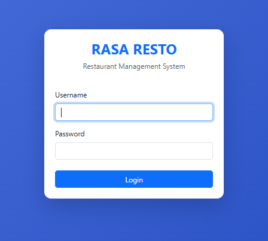

*Halaman autentikasi pengguna.*

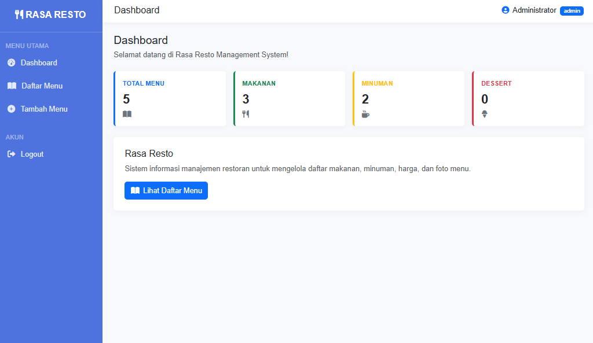

*Tampilan halaman utama Rasa Resto.*

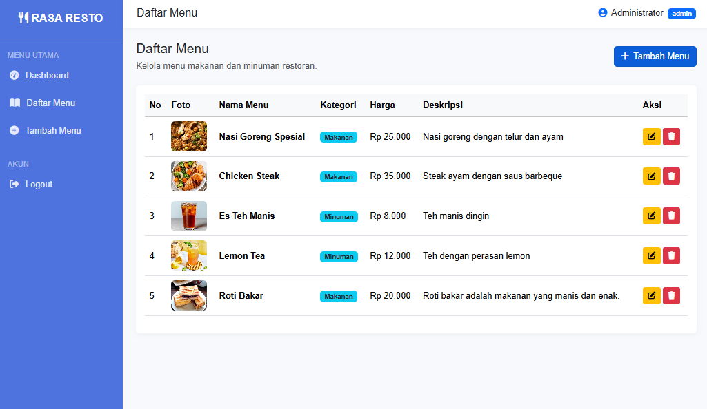

*Tampilan daftar menu Rasa Resto.*

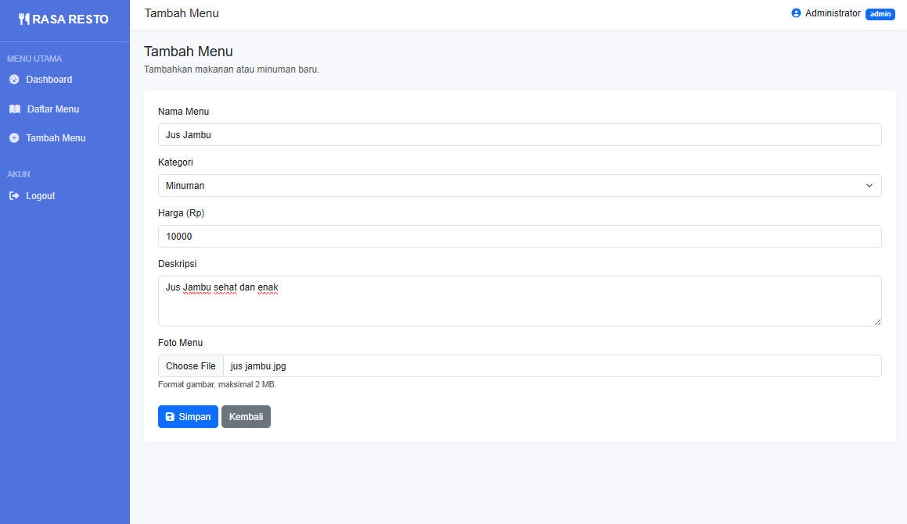

*Implementasi CRUD.*

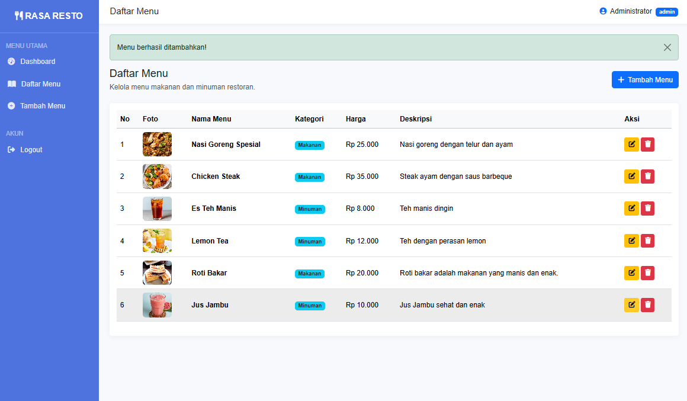

*Tampilan setelah CRUD tambah menu.*

## 2. Latihan 2A — SIAKAD

Pada latihan kedua bagian A, saya mengembangkan aplikasi Sistem Informasi Akademik (SIAKAD) untuk mengelola data akademik. Aplikasi ini mencakup pengelolaan data mahasiswa, dosen, mata kuliah, Kartu Rencana Studi (KRS), dan nilai mahasiswa. Pengembangan aplikasi menggunakan CodeIgniter 4 dengan menerapkan konsep MVC. Model digunakan untuk mengelola data pada database, Controller menangani proses aplikasi, sedangkan View bertanggung jawab menampilkan informasi kepada pengguna. Melalui latihan ini, saya mempelajari penerapan konsep MVC dalam pengembangan sistem informasi yang memiliki beberapa entitas data dan kebutuhan pengelolaan yang berbeda.

**Dokumentasi:**

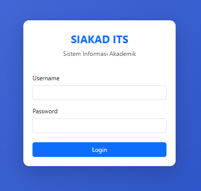

*Halaman autentikasi pengguna.*

*Tampilan halaman utama SIAKAD.*

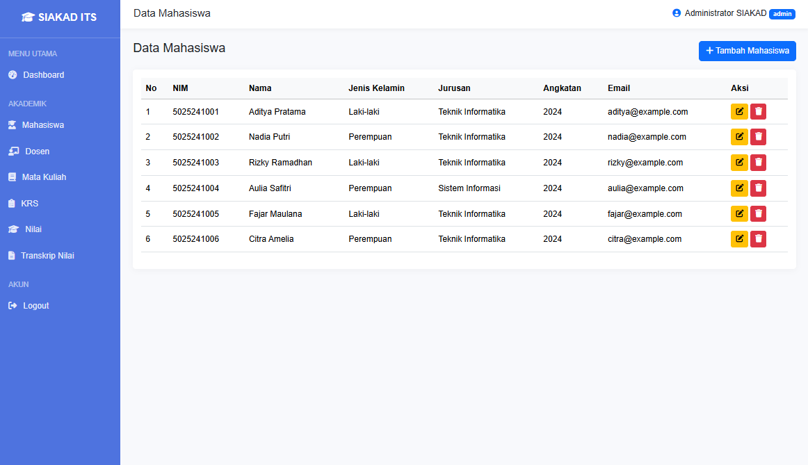

*Halaman pengelolaan data mahasiswa.*

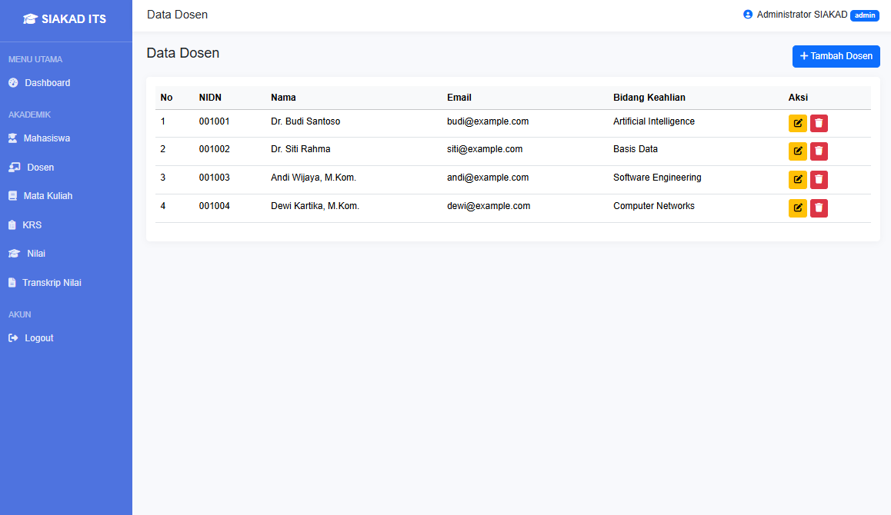

*Halaman pengelolaan data dosen.*

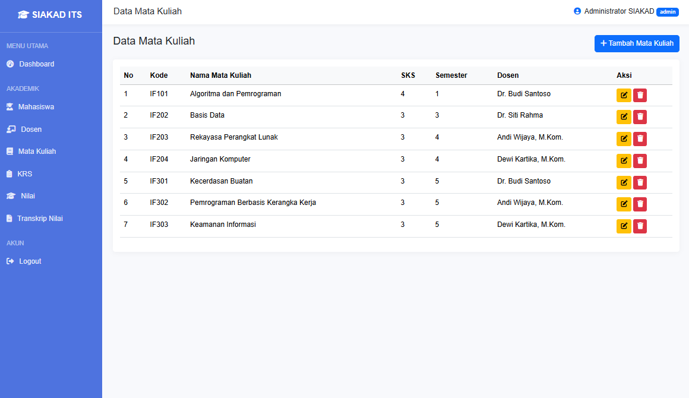

*Halaman pengelolaan data mata kuliah.*

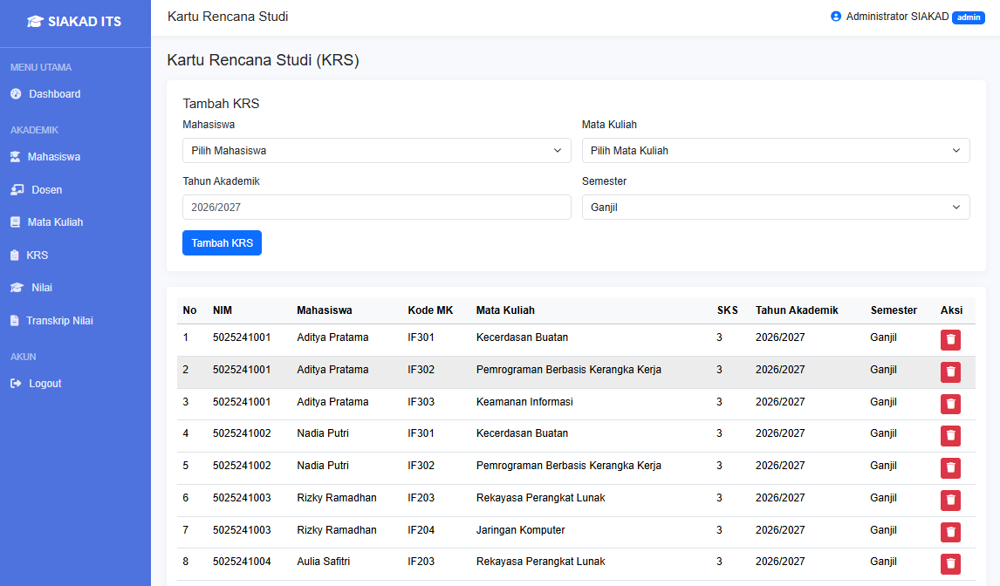

*Halaman pengelolaan data KRS.*

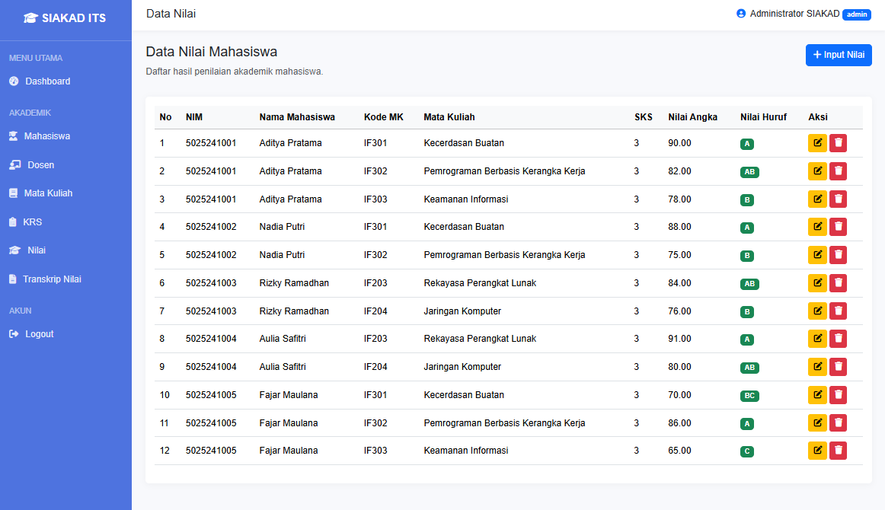

*Halaman pengelolaan data nilai.*

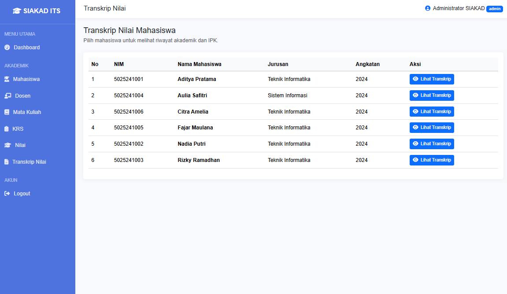

*Halaman pengelolaan transkrip.*

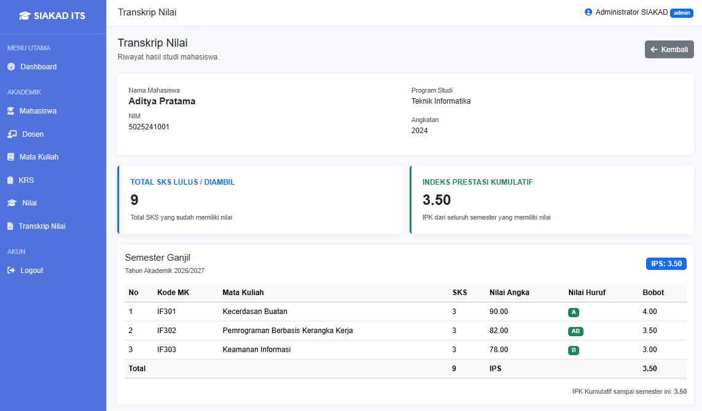

*Tampilan transkrip salah satu mahasiswa.*

## 3. Latihan 2B — Vaselle

Pada latihan kedua bagian B, saya mengembangkan Vaselle, yaitu aplikasi e-commerce sederhana yang berfokus pada penjualan produk vas dan dekorasi rumah. Aplikasi ini dikembangkan menggunakan CodeIgniter 4 dan MySQL dengan menerapkan konsep MVC. Terdapat dua jenis pengguna dalam aplikasi, yaitu admin dan customer, yang memiliki hak akses serta fungsionalitas berbeda. 

Fitur customer meliputi registrasi dan login, melihat katalog serta detail produk, mengelola keranjang belanja, melakukan checkout, dan melihat riwayat pesanan. Sementara itu, admin dapat mengelola data produk melalui operasi CRUD, mengunggah foto produk, serta memantau dan memperbarui status pesanan.

Database aplikasi menggunakan `db_vaselle` yang terdiri dari empat tabel utama, yaitu `users`, `products`, `orders`, dan `order_items`. Keempat tabel tersebut saling berhubungan untuk mendukung proses pengelolaan pengguna, produk, dan transaksi pesanan.

Untuk metode pembayaran, aplikasi menyediakan simulasi transfer bank dan Cash on Delivery (COD). Implementasi ini belum menggunakan integrasi payment gateway.

**Dokumentasi:**

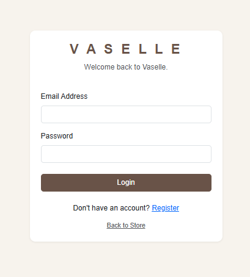

*Halaman login Vaselle.*

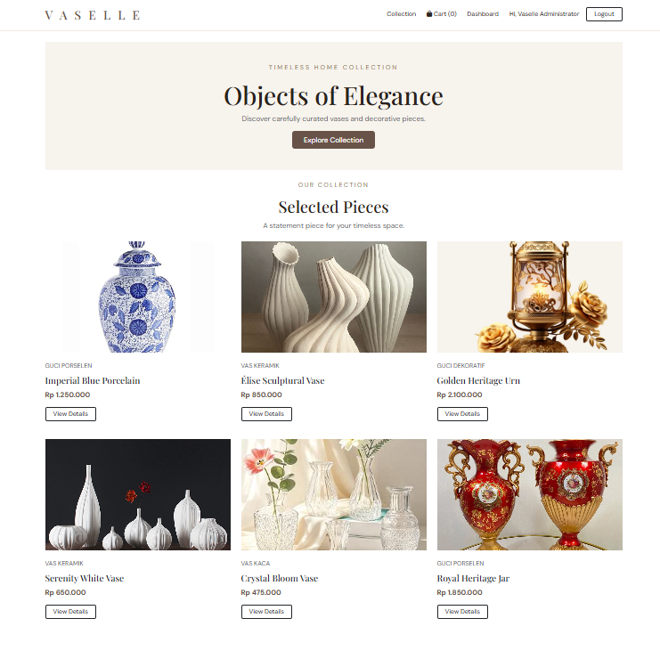

*Katalog produk Vaselle.*

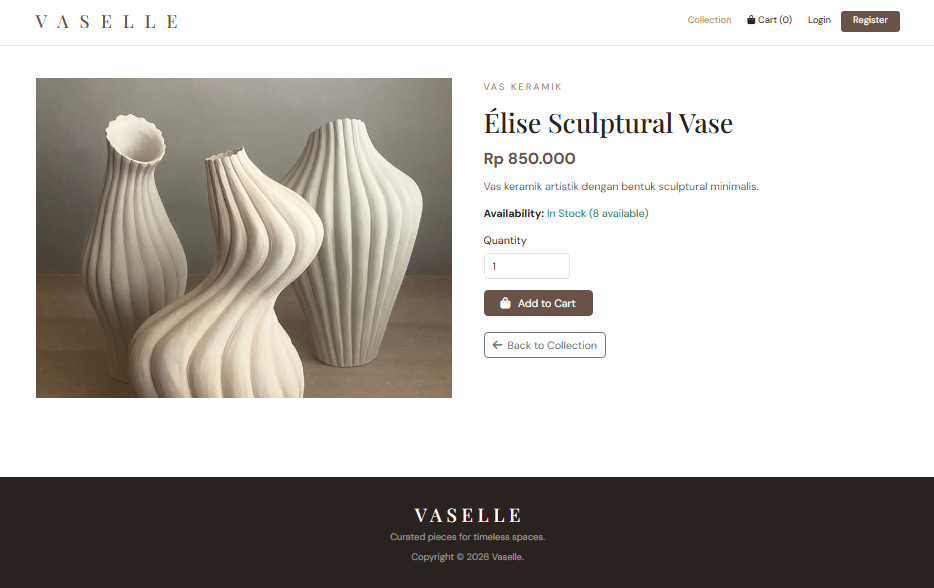

*Tampilan salah satu produk Vaselle.*

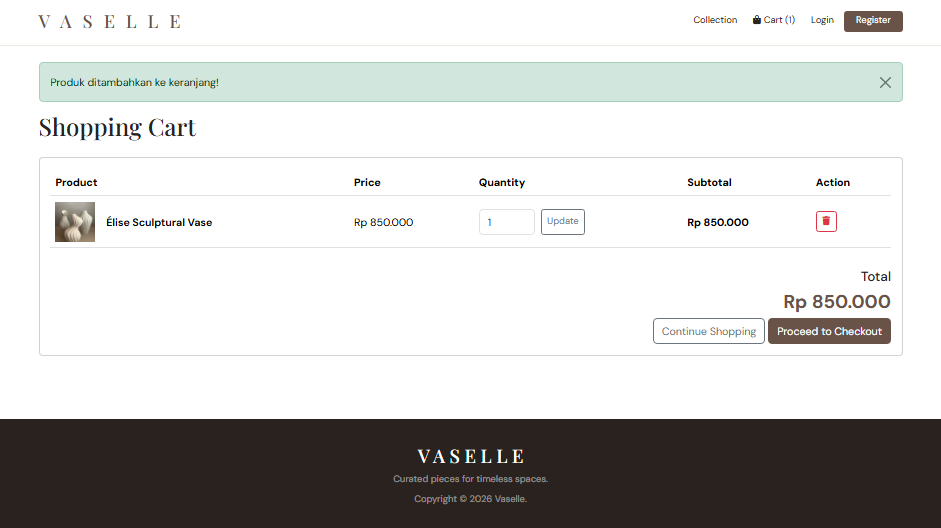

*Fitur keranjang belanja.*

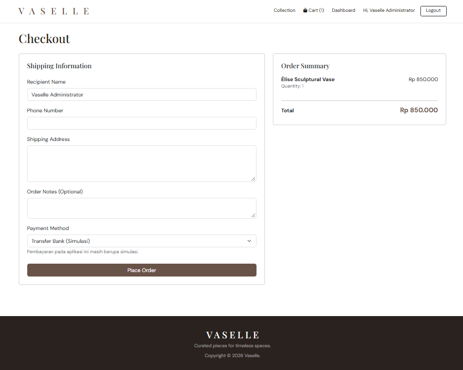

*Fitur keranjang checkout.*

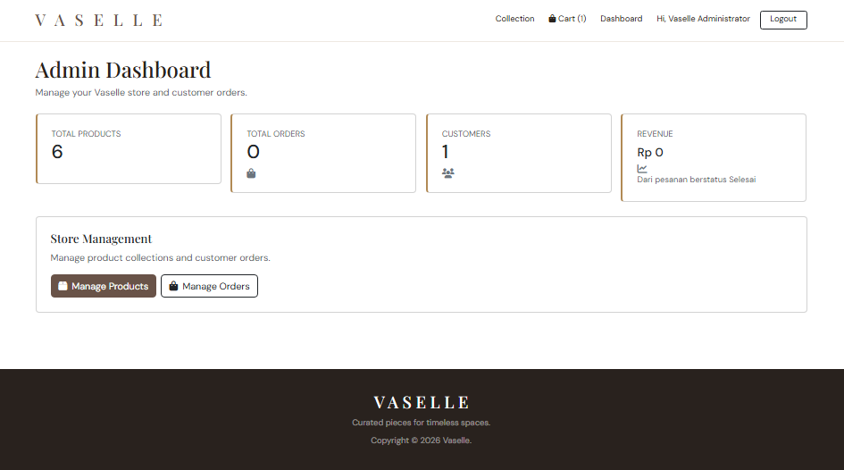

*Dashboard admin.*

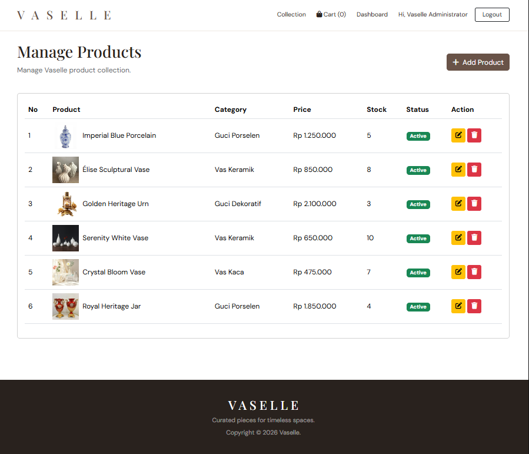

*Halaman pengelolaan produk oleh admin.*

## Kesimpulan

Melalui ketiga latihan ini, saya mempelajari pengembangan aplikasi web menggunakan framework CodeIgniter 4, mulai dari memahami struktur dasar framework hingga menerapkan berbagai fitur dalam aplikasi. Saya juga memperoleh pemahaman mengenai penggunaan MVC, pengelolaan database, operasi CRUD, file upload, autentikasi pengguna, serta pengaturan hak akses. Pengerjaan Rasa Resto, SIAKAD, dan Vaselle memberikan pengalaman dalam menerapkan materi praktikum ke dalam aplikasi dengan kebutuhan dan fungsionalitas yang berbeda.

**GitHub Repository:** [PBKK — Latihan 1 & Latihan 2](https://github.com/nanaaapid/PBKK/9_Latihan1_Latihan2)